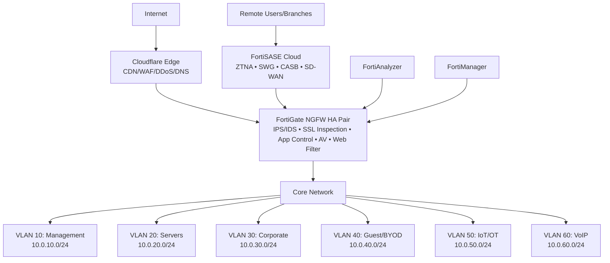
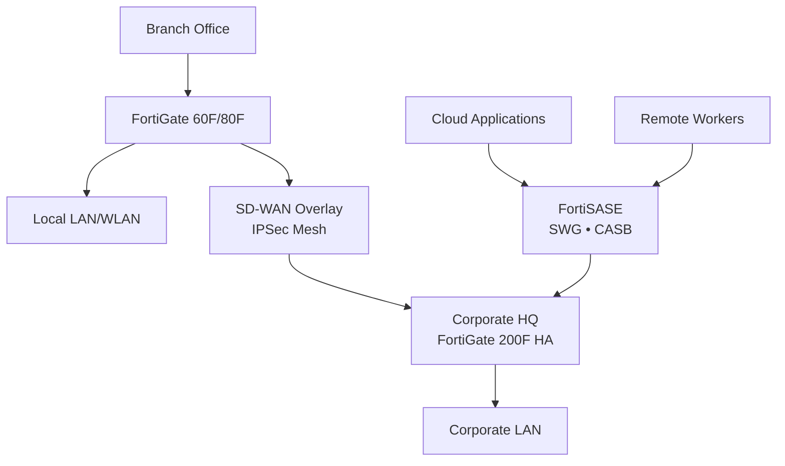

# Fortinet Network Security — BRIDA IT Services

Complete reference for designing, implementing, and managing Fortinet-based network security solutions for BRIDA IT Services clients. Combines firewall architecture, hardening, VPN, segmentation, SD-WAN, Zero Trust, monitoring, and incident response into a single comprehensive resource.

## 🎯 Overview

This skill consolidates all Fortinet network security knowledge for BRIDA IT Services, covering:
- **Complete Fortinet Security Fabric**: FortiGate (NGFW), FortiSASE (Zero Trust), FortiSwitch, FortiAP, FortiAnalyzer, FortiManager, FortiClient, FortiWeb, FortiMail
- **Network Architecture Design**: Perimeter security, branch office SD-WAN, data center segmentation
- **Firewall Hardening & Configuration**: Admin security, policies, UTM, logging, HA
- **Advanced Security Features**: IDS/IPS, SSL inspection, application control, web filtering
- **VPN Solutions**: Site-to-site IPsec, SSL-VPN for remote access
- **Network Segmentation**: VLANs, private VLANs, microsegmentation
- **SD-WAN Implementation**: Link balancing, SLA, SLA, application steering
- **Zero Trust Network Access (ZTNA)**: FortiSASE architecture, posture checking, policy enforcement
- **Traffic Analysis & Monitoring**: NetFlow/sFlow, packet capture, session analysis, SIEM integration
- **Incident Response**: Playbooks for intrusion, DDoS, data exfiltration, VPN compromise
- **Cloudflare Integration**: CDN/WAF/DDoS protection layered with FortiGate
- **Auditing & Compliance**: PCI-DSS, ISO 27001, NIST CSF validation
- **Framework Mapping**: MITRE ATT&CK, NIST CSF 2.0, MITRE D3FEND countermeasures

## 🏗️ Reference Architecture

### Enterprise Architecture (Corporate Headquarters)


### Branch Office Architecture (SD-WAN)


## 🔧 Core Fortinet Product Stack

| Product | Function | Typical Use Case |
|---------|----------|------------------|
| **FortiGate** | NGFW (Next-Gen Firewall) | Perimeter security, IDS/IPS, VPN, SSL inspection |
| **FortiSASE** | Secure Access Service Edge | Zero Trust, ZTNA, SWG, CASB, SD-WAN orchestration |
| **FortiSwitch** | Managed LAN Switches | Secure access layer, PoE, VLAN stacking |
| **FortiAP** | Managed Wireless APs | Secure WiFi, captive portal, rogue AP detection |
| **FortiAnalyzer** | Logging, Reporting, SIEM | Log aggregation, threat hunting, compliance |
| **FortiManager** | Centralized Management | Policy/firmware management for 100+ devices |
| **FortiClient** | Endpoint Agent | VPN/ZTNA connector, EDR, vulnerability scanning |
| **FortiWeb** | Web Application Firefill (WAF) | OWASP Top 10 protection, API security |
| **FortiMail** | Email Security | Anti-phishing, sandboxing, DLP, encryption |
| **FortiDDoS** | DDoS Protection | Volumetric and application-layer attack mitigation |

## 📋 When to Use This Skill

- **New Implementation**: Designing and deploying Fortinet security fabric from scratch
- **Infrastructure Refresh**: Upgrading existing firewalls to current FortiOS/hardware
- **Security Hardening**: Applying baseline hardening to existing FortiGate deployments
- **VPN/SD-WAN Projects**: Implementing site-to-site or remote access solutions
- **Zero Trust Initiatives**: Deploying ZTNA for remote users/branch offices
- **Monitoring & Response**: Setting up network visibility, alerting, and incident response
- **Compliance Projects**: Preparing for PCI-DSS, ISO 27001, NIST CSF audits
- **Troubleshooting**: Diagnosing performance, connectivity, or security issues

## ⚙️ Initial Setup & Hardening

### Phase 1: Administrative Security
```bash
# Change default admin password immediately
config system admin
    edit "admin"
        set password <STRONG_PASSWORD>
    next
end

# Create individual admin accounts (no sharing)
config system admin
    edit "netadmin-jperez"
        set accprofile "netadmin"
        set vdom "root"
        set password <STRONG_PASSWORD>
        set trusthost1 10.0.10.0/24  # Management subnet only
    next
end

# Disable default admin account after creating others
config system admin
    edit "admin"
        set status disable
    next
end

# Configure admin access protocols (HTTPS/SSH only)
config system global
    set admin-port 8443          # HTTPS management
    set admin-sport 8443
    set admin-ssh-port 8022
    set admin-https-redirect enable
    set admin-ssh-grace-time 30
    set admin-ssh-password-disable  # Require SSH keys
    set gui-https-redirect enable
    set gui-usb-image-download disable
    set gui-wireless-opensecurity disable
end

# Configure strong password policy
config system password-policy
    set status enable
    set minimum-length 12
    set require-uppercase enable
    set require-lowercase enable
    set require-numeric enable
    set require-special-character enable
    set expire 90
    set reuse 5
end

# Enable multi-factor authentication (MFA) for admins
config user local
    edit "admin"
        set two-factor fortitoken
        set fortitoken "FTKxxxxxxxxxxxx"
        set email-to "admin@company.com"
    next
end
```

### Phase 2: Interface & Service Hardening
```bash
# Disable unnecessary services on interfaces
config system interface
    edit "port1"  # WAN interface
        set allowaccess ping        # Only ping allowed from WAN
        set role wan
    next
    edit "port4"  # LAN interface
        set allowaccess ping https ssh  # Management only from LAN
        set role lan
    next
    edit "port5"  # DMZ interface
        set allowaccess ping https ssh
        set role dmz
    next
end

# Disable unused features globally
config system global
    set ssl-min-prover tls1-2      # Minimum TLS 1.2
    set strong-crypto enable       # Only strong ciphers
    set check-reset-range enable   # Protect against TCP RST injection
    set tcp-halfclose-timer 120
    set tcp-halfopen-timer 10
    set tcp-timewait-timer 1
    set udp-idle-timer 180
    set gui-dns-database disable
    set gui-explicit-proxy disable
    set gui-dynamic-routing disable
    set gui-ipsec-manualkey disable
    set gui-replacement-message-groups disable
    set gui-wan-load-balancing disable
    set gui-wireless-controller disable
end

# Disable legacy/insecure protocols
config system snmp sysinfo
    set status disable             # Disable SNMP v1/v2c
end

# Configure NTP for time synchronization (critical for logging/correlation)
config system ntp
    set ntpsync enable
    set syncinterval 60
    config ntpserver
        edit 1
            set server "time.google.com"
            set ntpv3 enable
        next
        edit 2
            set server "time.cloudflare.com"
            set ntpv3 enable
        next
    end
end
```

### Phase 3: Logging & Monitoring Setup
```bash
# Configure centralized logging to FortiAnalyzer
config log fortianalyzer setting
    set status enable
    set server "10.0.10.6"        # FortiAnalyzer IP
    set reliable enable           # Reliable delivery (TCP)
    set upload-option realtime    # Real-time log forwarding
    set enc-algorithm high        # AES-256 encryption
    set upload-day Monday
    set upload-time 02:00
end

# Configure syslog forwarding to external SIEM (optional)
config log syslogd setting
    set status enable
    set server "10.0.10.7"        # External SIEM/IP
    set port 514
    set facility local6
    set format cef                # Common Event Format
    set mode udp                  # Use TCP for reliability if needed
    set csv disable
end

# Enable logging on ALL firewall policies (critical for visibility)
config firewall policy
    edit 1
        set logtraffic all
        set logtraffic-start enable
        set utm-status enable
    next
end

# Configure alerting for critical events
config alertemail setting
    set username "soc@company.com"
    set mailto1 "soc@company.com"
    set mailto2 "sec-manager@company.com"
    set filter-mode category
    set CPU filter
    set memory filter
    set disk filter
    set session filter
    set IPsec filter
    set SSL-VPN filter
    set admin-login filter
    set HA filter
    set license filter
    set intrusion filter
    set anomaly filter
    set virus filter
    set ssh filter
    set violation filter
    set vpn-event filter
end
```

## 🔥 Firewall Policy Hardening

### Default-Deny Posture (Implicit Deny)
```bash
# Management access (restrictive)
config firewall policy
    edit 10
        set name "MGMT-Access"
        set srcintf "port5"         # Management interface
        set dstintf "any"
        set srcaddr "MGMT-Servers" "Jump-Server"
        set dstaddr "All"
        set action accept
        set schedule "always"
        set service "HTTPS" "SSH" "PING" "SNMP"
        set logtraffic all
        set logtraffic-start enable
        set utm-status enable
        set ssl-ssh-profile "deep-inspection"
        set av-profile "default"
        set ips-sensor "default"
        set application-list "default"
        set nat enable
        set comments "Management access from approved jump servers only"
    next
end

# Internal → Internet (with full inspection)
config firewall policy
    edit 20
        set name "Internal-to-Internet"
        set srcintf "port4"         # LAN interface
        set dstintf "port1"         # WAN interface
        set srcaddr "VLAN30-Corporate"
        set dstaddr "all"
        set action accept
        set schedule "always"
        set service "ALL"
        set utm-status enable
        set webfilter-profile "corporate-web-filter"
        set ssl-ssh-profile "certificate-inspection"
        set av-profile "default"
        set ips-sensor "default"
        set application-list "corporate-apps"
        set nat enable
        set logtraffic all
        set comments "Corporate user internet access with full UTM inspection"
    next
end

# DMZ → Internet (restricted)
config firewall policy
    edit 30
        set name "DMZ-to-Internet-Restricted"
        set srcintf "port3"         # DMZ interface
        set dstintf "port1"         # WAN interface
        set srcaddr "DMZ-Servers"
        set dstaddr "all"
        set action accept
        set schedule "always"
        set service "HTTP" "HTTPS" "DNS" "NTP"
        set utm-status enable
        set av-profile "default"
        set ips-sensor "default"
        set nat enable
        set logtraffic all
        set comments "DMZ servers with limited Internet access"
    next
end

# Explicit deny-all rule (for logging visibility)
config firewall policy
    edit 999
        set name "DENY-ALL-IMPLICIT"
        set srcintf "any"
        set dstintf "any"
        set srcaddr "all"
        set dstaddr "all"
        set action deny
        set schedule "always"
        set service "ALL"
        set logtraffic all
        set comments "Explicit deny-all for logging unauthorized attempts"
    next
end
```

## 🛡️ Intrusion Prevention System (IPS) Configuration

### IPS Sensor Configuration
```bash
# Create primary IPS sensor
config ips sensor
    edit "default"
        set comment "Primary IPS Sensor - Enterprise Protection"
        config entries
            # Critical web application attacks
            edit 1
                set rule 16443      # SQL Injection
                set status enable
                set log enable
                set action block
                set severity high critical
                set location server
                set os Linux Windows
                set protocol TCP
                set application "Web_Server"
            next
            edit 2
                set rule 16444      # Cross-Site Scripting (XSS)
                set status enable
                set log enable
                set action block
                set severity high critical
            next
            edit 3
                set rule 16445      # Command Injection
                set status enable
                set log enable
                set action block
                set severity critical
            next
            edit 4
                set rule 16446      # Buffer Overflow
                set status enable
                set log enable
                set action block
                set severity critical
            next
            edit 5
                set rule 16447      # Specific CVE example
                set status enable
                set log enable
                set action block
                set severity critical
                set cve "CVE-2024-XXXX"
            next
            # Brute force / authentication attacks
            edit 6
                set rule 1000028    # SSH brute force
                set status enable
                set log enable
                set action block
                set severity high
                set protocol TCP
                set destination-port 22
            next
            # Suspicious scanning behavior
            edit 7
                set rule 1000030    # Port scan detection
                set status enable
                set log enable
                set action monitor
                set severity medium
                set protocol TCP
                set destination-port 1-1024
                set threshold 10    # Alert after 10 ports scanned
            next
        end
    next

# IoT/OT specific IPS sensor
    edit "iot-protection"
        set comment "IPS Sensor - IoT/OT Device Protection"
        config entries
            edit 1
                set rule 16500      # Mirai botnet signatures
                set status enable
                set log enable
                set action block
                set severity critical
            next
            edit 2
                set rule 16501      # MQTT exploitation attempts
                set status enable
                set log enable
                set action block
                set severity high critical
            next
            edit 3
                set rule 16502      # Modbus/TCP anomalies
                set status enable
                set log enable
                set action block
                set severity high
            next
        end
    next

# DMZ server protection
    edit "dmz-protection"
        set comment "IPS Sensor - DMZ Server Protection"
        config entries
            edit 1
                set rule 16600      # Web attack signatures
                set status enable
                set log enable
                set action block
                set severity high critical
                set location server
                set os Linux Windows
            next
            edit 2
                set rule 16601      # Mail server attacks
                set status enable
                set log enable
                set action block
                set severity high critical
            next
        end
    next
end

# Apply IPS sensors to firewall policies
config firewall policy
    edit 20
        set ips-sensor "default"
    next
    edit 30
        set ips-sensor "dmz-protection"
    next
    edit 40
        set ips-sensor "iot-protection"
    next
end
```

### IPS Global Settings
```bash
config ips global
    set fail-open enable          # Fail-open to avoid network downtime
    set packet-log enable         # Log packets that trigger signatures
    set session-log enable        # Log sessions associated with attacks
    set engine-count 4            # Utilize multiple CPU cores
    set socket-size 32
    set queue-size 16384
    set async-op enable           # Asynchronous signature processing
end

# Schedule automatic signature updates
config system autoupdate push-update
    set status enable
    set schedule "daily"
    set time 02:00
end

config system autoupdate schedule
    set frequency daily
    set time 02:00
end
```

## 🔐 VPN Configuration

### Site-to-Site IPsec VPN
```bash
# Phase 1: IKE Negotiation
config vpn ipsec phase1-interface
    edit "VPN-HQ-to-Branch001"
        set interface "port1"           # WAN interface
        set ike-version 2               # IKEv2 preferred
        set peertype any                # Accept any peer ID type
        set net-device disable          # Create virtual interface
        set proposal aes256-sha256      # AES-256 encryption, SHA-256 integrity
        set dhgrp 14 19 20              # DH Groups: 14(2048), 19(256-bit ECP), 20(384-bit ECP)
        set remote-gw 203.0.113.50      # Remote peer WAN IP
        set psksecret <STRONG_PSK>      # Pre-shared key (use strong random)
        set dpd-retrycount 3            # Dead Peer Detection
        set dpd-retryinterval 10
        set idle-timeout enable
        set idle-timeoutinterval 30
        set auto-negotiate enable       # Auto-reconnect if tunnel drops
        set add-route enable            # Auto-add static route for remote subnet
        set comments "IPsec VPN: HQ ↔ Branch Office 001"
    next
end

# Phase 2: IPsec Security Association
config vpn ipsec phase2-interface
    edit "VPN-HQ-to-Branch001-P2"
        set phase1name "VPN-HQ-to-Branch001"
        set proposal aes256-sha256 aes256-gcm  # AES-256 with SHA or GCM mode
        set dhgrp 14 19 20
        set pfs enable                  # Perfect Forward Secrecy
        set protocol esp
        set src-subnet 10.0.0.0/16      # HQ local network
        set dst-subnet 10.1.0.0/16      # Branch local network
        set keylifeseconds 3600         # 1 hour key lifetime
        set keylifekbs 51200            # 50MB key lifetime
        set auto-negotiate enable
        set comments "Phase 2: 10.0.0.0/16 ↔ 10.1.0.0/16"
    next
end

# Firewall policies for VPN traffic
config firewall address
    edit "Branch001-Network"
        set subnet 10.1.0.0/16
        set associated-interface "VPN-HQ-to-Branch001"
    next
end

config firewall policy
    edit 100
        set name "VPN-Branch001-Inbound"
        set srcintf "VPN-HQ-to-Branch001"
        set dstintf "port4"             # LAN interface
        set srcaddr "Branch001-Network"
        set dstaddr "VLAN30-Corporate"
        set action accept
        set schedule "always"
        set service "ALL"
        set utm-status enable
        set ips-sensor "default"
        set logtraffic all
        set comments "Traffic from Branch 001 to HQ corporate network"
    next
    edit 101
        set name "VPN-Branch001-Outbound"
        set srcintf "port4"
        set dstintf "VPN-HQ-to-Branch001"
        set srcaddr "VLAN30-Corporate"
        set dstaddr "Branch001-Network"
        set action accept
        set schedule "always"
        set service "ALL"
        set utm-status enable
        set ips-sensor "default"
        set logtraffic all
        set comments "Traffic from HQ corporate network to Branch 001"
    next
end

# VPN Diagnostics & Monitoring
diagnose vpn ike gateway list               # Check IKE gateway status
diagnose vpn tunnel list                    # Check active IPsec tunnels
diagnose debug application ike -1           # Enable IKE debugging
diagnose debug enable
get vpn ipsec tunnel summary                # Summary of all tunnels
```

### SSL-VPN (Remote Access)
```bash
# Configure SSL-VPN portal settings
config vpn ssl settings
    set servercert "Fortinet_Factory"     # Replace with proper cert in production
    set tunnel-ip-pools "SSLVPN_TUNNEL_ADDR1"
    source-interface "port1"              # WAN interface
    set source-address "all"
    set default-portal "full-access"
    set port 10443                        # Standard SSL-VPN port
    set idle-timeout 1800                 # 30 minutes idle timeout
    set login-attempt-limit 3             # Lockout after 3 failed attempts
    set login-block-time 60               # 1 minute lockout
    set dtls-tunnel enable                # Enable DTLS for better performance
    set algorithm high                    # Use strong cryptographic algorithms
end

# Configure web portal mode
config vpn ssl web portal
    edit "full-access"
        set tunnel-mode enable            # Enable tunnel mode (full network access)
        set web-mode enable               # Enable web mode (web proxy access)
        set ip-pools "SSLVPN_TUNNEL_ADDR1"
        set split-tunneling enable        # Allow split tunneling
        set split-tunneling-routing-address "VLAN30-Corporate" "VLAN20-Servers"
        set theme blue
        set display-bookmark enable
        set display-connection-tools enable
        set display-history enable
        set display-status enable
        set limit-user-logins enable
        set max-session-per-user 2
    next
    edit "web-only"
        set tunnel-mode disable           # Web mode only (no tunnel)
        set web-mode enable
        set web-mode-snat enable
        set theme green
        set comments "Web-only portal for specific application access"
    next
end

# Configure SSL-VPN users/groups
config user local
    edit "vpn-user-jperez"
        set type password
        set passwd <STRONG_PASSWORD>
        set two-factor fortitoken         # Enable 2FA
        set fortitoken "FTKxxxxxxxxxxxx"
        set email-to "jperez@company.com"
    next
end

config user group
    edit "SSLVPN-Users"
        set member "vpn-user-jperez"
    next
end

# Firewall policy for SSL-VPN traffic
config firewall policy
    edit 150
        set name "SSLVPN-Access"
        set srcintf "ssl.root"            # SSL-VPN virtual interface
        set dstintf "port4"               # LAN interface
        set srcaddr "SSLVPN_TUNNEL_ADDR1"
        set dstaddr "VLAN30-Corporate" "VLAN20-Servers"
        set action accept
        set schedule "always"
        set service "ALL"
        set utm-status enable
        set ssl-ssh-profile "certificate-inspection"
        set ips-sensor "default"
        set logtraffic all
        set comments "SSL-VPN users accessing corporate resources"
    next
end

# SSL-VPN Diagnostics
diagnose debug application sslvpn -1
diagnose debug enable
get vpn ssl monitor                         # Monitor active SSL-VPN sessions
get vpn ssl statistics                      # SSL-VPN connection statistics
```

## 🌐 Network Segmentation (VLANs)

### VLAN Design & Subnet Planning
```bash
# Recommended VLAN scheme for mid-market clients
config system interface
    # Management VLAN (isolated, secure)
    edit "vlan10"
        set vdom "root"
        set ip 10.0.10.1/24
        set allowaccess ping https ssh
        set role lan
        set snmp-index 10
        set interface "port4"             # Trunk port connected to switch
        set vlanid 10
        set comments "Management VLAN - Network infrastructure"
    next
    
    # Servers VLAN
    edit "vlan20"
        set vdom "root"
        set ip 10.0.20.1/24
        set allowaccess ping
        set role lan
        set snmp-index 20
        set interface "port4"
        set vlanid 20
        set comments "Servers VLAN - Domain controllers, DB, web servers"
    next
    
    # Corporate Users VLAN
    edit "vlan30"
        set vdom "root"
        set ip 10.0.30.1/24
        set allowaccess ping
        set role lan
        set snmp-index 30
        set interface "port4"
        set vlanid 30
        set comments "Corporate Users VLAN - Workstations, laptops"
    next
    
    # Guest/BYOD VLAN
    edit "vlan40"
        set vdom "root"
        set ip 10.0.40.1/24
        set allowaccess ping
        set role lan
        set snmp-index 40
        set interface "port4"
        set vlanid 40
        set comments "Guest/BYOD VLAN - Visitor devices, personal phones"
    next
    
    # IoT/OT VLAN
    edit "vlan50"
        set vdom "root"
        set ip 10.0.50.1/24
        set allowaccess ping
        set role lan
        set snmp-index 50
        set interface "port4"
        set vlanid 50
        set comments "IoT/OT VLAN - Cameras, sensors, industrial devices"
    next
    
    # VoIP VLAN
    edit "vlan60"
        set vdom "root"
        set ip 10.0.60.1/24
        set allowaccess ping
        set role lan
        set snmp-index 60
        set interface "port4"
        set vlanid 60
        set comments "VoIP VLAN - IP phones, soft clients"
    next
end
```

### VLAN-Specific DHCP Configuration
```bash
# DHCP server for each VLAN
config system dhcp server
    # Management VLAN - static assignments preferred
    edit 1
        set interface "vlan10"
        set netmask 255.255.255.0
        set default-gateway 10.0.10.1
        set dns-service default  # Use FortiGate DNS or external
        set next-hop 10.0.10.1
        set lease-time 86400     # 24 hour lease
        config ip-range
            edit 1
                set start-ip 10.0.10.100
                set end-ip 10.0.10.200
            next
        end
    next
    
    # Corporate Users VLAN
    edit 2
        set interface "vlan30"
        set netmask 255.255.255.0
        set default-gateway 10.0.30.1
        set dns-service default
        set next-hop 10.0.30.1
        set lease-time 43200     # 12 hour lease
        config ip-range
            edit 1
                set start-ip 10.0.30.100
                set end-ip 10.0.30.250
            next
        end
    next
    
    # Guest/BYOD VLAN - shorter lease time
    edit 3
        set interface "vlan40"
        set netmask 255.255.255.0
        set default-gateway 10.0.40.1
        set dns-service default
        set next-hop 10.0.40.1
        set lease-time 14400     # 4 hour lease (frequent rotation)
        config ip-range
            edit 1
                set start-ip 10.0.40.100
                set end-ip 10.0.40.200
            next
        end
    next
    
    # IoT/OT VLAN - static or DHCP reservations recommended
    edit 4
        set interface "vlan50"
        set netmask 255.255.255.0
        set default-gateway 10.0.50.1
        set dns-service default
        set next-hop 10.0.50.1
        set lease-time 86400     # 24 hour lease
        # For critical IoT devices, consider MAC-based reservations instead
    next
end
```

### Inter-VLAN Segregation Policies
```bash
# Default: Deny all inter-VLAN traffic (principle of least privilege)
config firewall policy
    edit 998
        set name "INTER-VLAN-DENY-DEFAULT"
        set srcintf "vlan10" "vlan20" "vlan30" "vlan40" "vlan50" "vlan60"
        set dstintf "vlan10" "vlan20" "vlan30" "vlan40" "vlan50" "vlan60"
        set srcaddr "all"
        set dstaddr "all"
        set action deny
        set schedule "always"
        set service "ALL"
        set logtraffic all
        set comments "Default deny for all inter-VLAN traffic"
    next
end

# Allow specific required inter-VLAN communication
# Management → All (for monitoring/management)
config firewall policy
    edit 10
        set name "MGMT-To-All-VLANs"
        set srcintf "vlan10"
        set dstintf "vlan20" "vlan30" "vlan40" "vlan50" "vlan60"
        set srcaddr "MGMT-Servers"
        set dstaddr "all"
        set action accept
        set schedule "always"
        set service "ALL"
        set utm-status enable
        set logtraffic all
        set comments "Management servers can access all VLANs for monitoring"
    next
end

# Corporate Users → Servers (common business applications)
config firewall policy
    edit 20
        set name "Corp-To-Servers"
        set srcintf "vlan30"
        set dstintf "vlan20"
        set srcaddr "VLAN30-Corporate"
        set dstaddr "SRV-Web" "SRV-DB" "SRV-DC" "SRV-Mail"
        set action accept
        set schedule "always"
        set service "HTTP" "HTTPS" "DNS" "LDAP" "LDAPS" "SMTP" "SMTPS" "IMAP" "IMAPS" "MSSQL" "MySQL"
        set utm-status enable
        set ips-sensor "default"
        set logtraffic all
        set comments "Corporate users accessing business applications"
    next
end

# Guest/BYOD → Internet Only (no internal access)
config firewall policy
    edit 30
        set name "Guest-Internet-Only"
        set srcintf "vlan40"
        set dstintf "port1"           # WAN interface
        set srcaddr "VLAN40-Guest"
        set dstaddr "all"
        set action accept
        set schedule "always"
        set service "HTTP" "HTTPS" "DNS" "NTP"
        set utm-status enable
        set webfilter-profile "guest-web-filter"
        set ssl-ssh-profile "certificate-inspection"
        set av-profile "default"
        set ips-sensor "default"
        set nat enable
        set logtraffic all
        set comments "Guest users can only access Internet (no internal resources)"
    next
end

# IoT/OT → Specific Services Only (principle of least privilege)
config firewall policy
    edit 40
        set name "IoT-Limited-Access"
        set srcintf "vlan50"
        set dstintf "vlan20"
        set srcaddr "VLAN50-IoT"
        set dstaddr "SRV-NTP" "SRV-MQTT" "SRV-Monitoring"
        set action accept
        set schedule "always"
        set service "NTP" "MQTT" "HTTPS"
        set utm-status enable
        set ips-sensor "iot-protection"
        set logtraffic all
        set comments "IoT devices can only communicate with essential services"
    next
    # Deny all other IoT traffic
    edit 41
        set name "IoT-Deny-All-Else"
        set srcintf "vlan50"
        set dstintf "any"
        set srcaddr "VLAN50-IoT"
        set dstaddr "all"
        set action deny
        set schedule "always"
        set service "ALL"
        set logtraffic all
        set comments "Block all other IoT traffic"
    next
end

# VoIP → Internet & Call Control (with QoS considerations)
config firewall policy
    edit 50
        set name "VoIP-Outbound"
        set srcintf "vlan60"
        set dstintf "port1"           # WAN interface
        set srcaddr "VLAN60-VoIP"
        set dstaddr "all"
        set action accept
        set schedule "always"
        set service "SIP" "RTP" "HTTP" "HTTPS"
        set utm-status enable
        set ips-sensor "default"
        set nat enable
        set logtraffic all
        set comments "VoIP traffic to Internet for external calls"
    next
end
```

## 🔄 SD-WAN Implementation

### Basic SD-WAN Configuration
```bash
# Enable SD-WAN and add member interfaces
config system sdwan
    set status enable
    # Member 1: Primary ISP (Fiber)
    config members
        edit 1
            set interface "port1"       # WAN1 - Primary fiber link
            set virtual-wan-link enable
            set cost 10                 # Lower cost = preferred
            set weight 1                # Equal weight for load balancing
            set source 10.0.0.1
            set gateway 198.51.100.1    # Primary ISP gateway
            set comments "ISP Primary - Fiber 1Gbps"
        next
        # Member 2: Secondary ISP (Cable/Broadband)
        edit 2
            set interface "port2"       # WAN2 - Secondary link
            set virtual-wan-link enable
            set cost 20                 # Higher cost = backup
            set weight 1
            set source 10.0.0.2
            set gateway 198.51.200.1    # Secondary ISP gateway
            set comments "ISP Backup - Cable 500Mbps"
        next
        # Member 3: LTE Failover (USB/4G dongle)
        edit 3
            set interface "port7"       # LTE/USB interface
            set virtual-wan-link enable
            set cost 30                 # Highest cost = last resort
            set weight 1
            set source 10.0.0.3
            set comments "LTE Failover - 4G/5G"
        next
    end
    
    # Health check for link quality monitoring
    config health-check
        edit "Ping-Google-DNS"
            set server 8.8.8.8          # Google DNS
            set protocol ping
            set interval 5000           # 5 second interval
            set failtime 3              # 3 consecutive failures = down
            set recoverytime 3          # 3 successes = restored
            set update-static-route enable
            set sla
                edit 1
                    set id 1
                next
            end
        next
        edit "Ping-Cloudflare-DNS"
            set server 1.1.1.1          # Cloudflare DNS
            set protocol ping
            set interval 5000
            set failtime 3
            set recoverytime 3
            set update-static-route enable
            set sla
                edit 1
                    set id 1
                next
            end
        next
    end
    
    # Service rules for traffic steering
    config service
        # Voice/Video traffic: highest priority, lowest latency path
        edit 1
            set name "Voice-Video-Priority"
            set mode priority           # Use priority-based selection
            set src "VLAN60-VoIP"       # VoIP VLAN
            set dst "all"
            set priority-members 1      # Always use primary link (member 1)
            set health-check "Ping-Google-DNS"
            set comments "VoIP/video: always use primary ISP for lowest latency"
        next
        
        # Critical business applications: prefer primary, failover to secondary
        edit 2
            set name "Business-Critical"
            set mode priority
            set src "VLAN30-Corporate"
            set dst "SRV-ERP" "SRV-CRM" "SRV-DB"
            set priority-members 1 2    # Try primary first, then secondary
            set health-check "Ping-Google-DNS"
            set comments "ERP/CRM/DB: primary preferred, secondary failover"
        next
        
        # General internet traffic: load balanced across all healthy links
        edit 3
            set name "Internet-General"
            set mode load-balance       # Distribute traffic across links
            set src "VLAN30-Corporate"
            set dst "all"
            set priority-members 1 2 3  # Use all available links
            set load-balance-algorithm source-ip-hash  # Consistent flow mapping
            set comments "General web browsing: load balanced across ISPs"
        next
        
        # Guest/BYOD traffic: secondary preferred, LTE fallback
        edit 4
            set name "Guest-Internet"
            set mode priority
            set src "VLAN40-Guest"
            set dst "all"
            set priority-members 2 3    # Secondary first, then LTE
            set comments "Guest traffic: use backup ISP, fall back to LTE"
        next
        
        # IoT/OT traffic: primary link only (reliability critical)
        edit 5
            set name "IoT-Reliable"
            set mode priority
            set src "VLAN50-IoT"
            set dst "SRV-NTP" "SRV-MQTT"
            set priority-members 1      # Primary link only
            set health-check "Ping-Google-DNS"
            set comments "IoT/OT: primary link only for maximum reliability"
        next
    end
end

# Optional: SLA monitoring for specific applications (VoIP, video conferencing)
config system sdwan
    config health-check
        edit "VoIP-SLA-Monitoring"
            set server 8.8.8.8
            set protocol ping
            set interval 1000           # 1 second for VoIP sensitivity
            set failtime 3
            set recoverytime 3
            set sla
                edit 1
                    set id 1
                    set latency-threshold 50      # < 50ms latency
                    set jitter-threshold 20       # < 20ms jitter
                    set packetloss-threshold 1    # < 1% packet loss
                next
            end
            set comments "SLA monitoring for VoIP quality"
        next
    end
end

# SD-WAN Diagnostics & Monitoring
diagnose sys sdwan member                   # Check member interface status
diagnose sys sdwan service                  # Check service rule performance
diagnose sys sdwan health-check             # View health check results
diagnose sys sdwan sla-log                  # Review SLA compliance logs
diagnose sys sdwan history                  # See historical path selection
get router info routing-table all           # View routing table (includes SD-WAN routes)
diagnose sniffer packet "virtual-wan-link" "host 8.8.8.8" 4  # Monitor SD-WAN traffic
```

### Advanced SD-WAN Features
```bash
# Application control-based steering (requires FortiGuard licenses)
config application list
    edit "Business-Critical-Apps"
        config entries
            edit 1
                set application "Microsoft-SQLServer"
            next
            edit 2
                set application "SAP-GUI"
            next
            edit 3
                set application "Oracle-DB"
            next
        end
    next
end

# Use application visibility in SD-WAN service rules
config system sdwan
    config service
        edit 10
            set name "ERP-Application-Steering"
            set mode priority
            set src "VLAN30-Corporate"
            set dst "all"
            set application "Microsoft-SQLServer" "SAP-GUI" "Oracle-DB"
            set priority-members 1 2    # Primary preferred, secondary fallback
            set health-check "Ping-Google-DNS"
            set comments "Steer ERP database traffic based on SLA performance"
        next
    end
end

# SLA-based load balancing (send traffic to best performing link)
config system sdwan
    set load-balance-mode measured-rtt-bond  # Use measured RTT for LB decisions
    # or
    set load-balance-mode measured-qos-balance  # Use jitter/packet loss metrics
end
```

## 🛡️ Zero Trust Network Access (ZTNA) - FortiSASE

### ZTNA Core Principles Implementation
```bash
# Enable ZTNA on FortiGate (on-premises component)
config firewall access-proxy
    edit "ZTNA-WebApp"
        set client-cert enable          # Require client certificate
        set vip "VIP-Internal-WebApp"   # Virtual IP for the application
        set api-gateway "ZTNA-Gateway-WebApp"
    next
end

# Configure API Gateway (defines how ZTNA maps to internal services)
config firewall access-proxy
    edit "ZTNA-WebApp"
        set client-cert enable
        config api-gateway
            edit 1
                set url-map "/erp"                    # Map external /erp to internal
                set service HTTP
                set realservers
                    edit 1
                        set address "ERP-Server-Internal"
                        set http-port 8080
                        set health-check enable       # Monitor backend health
                    next
                end
                set ssl-ssh-profile "certificate-inspection"
                set client-cert enable                # Mutual TLS required
                set log-url enable                    # Log accessed URLs
            next
        end
    next
end

# Define ZTNA tags based on device posture
config user device-category
    edit "Corporate-Laptop-Managed"
        set comment "Fully managed corporate laptops (Intune/SCCM)"
    next
    edit "Personal-Device-BYOD"
        set comment "Employee-owned devices (BYOD)"
    next
    edit "Contractor-Device"
        set comment "Third-party contractor devices"
    next
end

# Assign devices to groups based on posture checks (via FortiClient EMS)
config user device-group
    edit "ZTNA-Trusted-Devices"
        set member "Corporate-Laptop-Managed"
    next
    edit "ZTNA-Limited-Access"
        set member "Personal-Device-BYOD"
    next
    edit "ZTNA-Restricted"
        set member "Contractor-Device"
    next
end

# Create ZTNA access policies based on identity + posture
config firewall proxy-policy
    # Full access: managed corporate devices + authenticated users
    edit 10
        set name "ZTNA-Full-Access"
        set proxy access-proxy
        set access-proxy "ZTNA-WebApp"
        set srcintf "ssl.root"        # SSL-VPN/ZTNA tunnel interface
        set srcaddr "all"
        set srcaddr6 "all"
        set dstaddr "VIP-Internal-WebApp"
        set srcaddr-user-type local   # Local user database
        set srcaddr-user "sales-team" "engineering" "management"
        set ztna-ems-tag "ZTNA-Trusted-Devices"  # Must be managed device
        set action accept
        set schedule "always"
        set service "HTTPS"
        set logtraffic all
        set comments "Fully managed devices + authorized employees = full access"
    next
    
    # Limited access: personal devices + authenticated users
    edit 20
        set name "ZTNA-Limited-Access"
        set proxy access-proxy
        set access-proxy "ZTNA-WebApp"
        set srcintf "ssl.root"
        set srcaddr "all"
        set dstaddr "VIP-Internal-WebApp"
        set srcaddr-user-type local
        set srcaddr-user "all"
        set ztna-ems-tag "ZTNA-Limited-Access"  # BYOD devices
        set action accept
        set schedule "always"
        set service "HTTPS"
        set http-policy-allow-download disable  # Block file downloads
        set http-policy-allow-upload disable    # Block file uploads
        set comments "Personal devices: view-only access to web applications"
    next
    
    # Restricted access: contractors/vendors
    edit 30
        set name "ZTNA-Restricted-Access"
        set proxy access-proxy
        set access-proxy "ZTNA-WebApp"
        set srcintf "ssl.root"
        set srcaddr "all"
        set dstaddr "VIP-Internal-WebApp"
        set srcaddr-user-type local
        set srcaddr-user "contractors" "vendors" "partners"
        set ztna-ems-tag "ZTNA-Restricted"     # Contractor devices
        set action accept
        set schedule "always"
        set service "HTTP" "HTTPS"
        set url-access
            edit 1
                set url "/erp/public/*"         # Only public-facing endpoints
                set action allow
            next
            edit 2
                set url "/erp/*"                # Block all other ERP paths
                set action deny
            next
        end
        set comments "Contractors: limited to specific public endpoints only"
    next
    
    # Default deny: unmanaged/unauthorized devices
    edit 99
        set name "ZTNA-Default-Deny"
        set proxy access-proxy
        set access-proxy "ZTNA-WebApp"
        set srcintf "ssl.root"
        set srcaddr "all"
        set dstaddr "VIP-Internal-WebApp"
        set action deny
        set schedule "always"
        set service "ALL"
        set comments "Block all unmanaged or unauthorized devices"
    next
end
```

### FortiSASE Cloud Configuration Concepts
```
[FortiSASE Tenant Setup - Conceptual/Reference]

1. Identity Provider Integration
   - Configure SAML/OIDC with Azure AD, Okta, Google Workspace
   - Enable group synchronization for role-based access
   - Implement Just-In-Time (JIT) provisioning

2. Device Posture Assessment (via FortiClient EMS)
   - OS Version: Windows 10/11 22H2+, macOS 13+
   - Antivirus: FortiClient or compatible AV with current signatures
   - Disk Encryption: BitLocker/FileVault enabled
   - Firewall: Local firewall active
   - Windows Defender: Real-time protection ON
   - Pending Reboots: None required
   - Patch Status: Critical security patches applied within 30 days

3. Zero Trust Network Access (ZTNA) Policies
   - Policy 1: Corporate Device + Compliant User → Full Access to Private Apps
   - Policy 2: Personal Device + Compliant User → Web App Access Only (No Download/Upload)
   - Policy 3: Non-Compliant Device → Quarantine (Remediation Portal Only)
   - Policy 4: Unmanaged Device → Deny All Access

4. Secure Web Gateway (SWG) Configuration
   - URL Filtering: Block malicious, high-risk, inappropriate categories
   - SSL Inspection: Deep inspection for encrypted threats
   - Application Control: Block high-risk applications (torrents, crypto-miners)
   - Data Loss Prevention: Prevent sensitive data exfiltration
   - Credential Phishing Protection: Detect fake login pages

5. Cloud Access Security Broker (CASB)
   - Discover shadow IT SaaS applications
   - Enforce access controls based on user role and device posture
   - Monitor for anomalous data sharing or download patterns
   - Apply encryption and DLP policies to sensitive cloud data

6. SD-WAN Orchestration
   - Create virtual WAN overlay connecting branches, HQ, cloud
   - Apply SLA-based routing for application performance
   - Implement seamless failover between MPLS, broadband, LTE
   - Optimize cloud access (direct-to-internet for SaaS, private for DC)
```

## 📡 Traffic Analysis & Monitoring

### NetFlow/sFlow Configuration
```bash
# Enable NetFlow collection on FortiGate
config system netflow
    set collector-ip 10.0.10.8        # NetFlow collector (often FortiAnalyzer)
    set collector-port 2055           # Standard NetFlow port
    set source-ip 10.0.10.1           # FortiGate interface IP
    set active-flow-timeout 1800      # 30 minutes for active flows
    set inactive-flow-timeout 15      # 15 seconds for idle flows
end

# Enable NetFlow on specific interfaces
config system interface
    edit "port1"      # WAN interface
        set netflow-sampler both      # Sample both ingress and egress
    next
    edit "port4"      # LAN interface
        set netflow-sampler both
    next
    edit "port3"      # DMZ interface
        set netflow-sampler both
    next
end

# Enable NetFlow per firewall policy (for granular application visibility)
config firewall policy
    edit 20         # Internal-to-Internet policy
        set netflow-sampler both
    next
end
```

### Packet Capture & Traffic Analysis
```bash
# Real-time packet capture to console
diagnose sniffer packet any "host 10.0.30.50" 4
diagnose sniffer packet "port1" "port 443" 4 l        # Long display with timestamps
diagnose sniffer packet "port4" "host 10.0.20.10 and port 3306" 4 l

# Packet capture to file (for later analysis with Wireshark)
diagnose sniffer packet any "host 10.0.30.50" 4 l /tmp/capture.pcap
diagnose sniffer packet "VPN-SiteA-to-SiteB" "" 4 l /tmp/vpn-traffic.pcap

# Analyze captured file
# Copy to analysis workstation and examine with Wireshark or tcpdiagnose

# Session-based diagnostics
diagnose sys session list                     # List all active sessions
diagnose sys session dst 10.0.30.50           # Filter by destination IP
diagnose sys session dport 443                # Filter by destination port
diagnose sys session proto 6                  # Filter by protocol (TCP=6)
diagnose sys session list                     # Show filtered results
diagnose sys session clear                    # Clear session table

# Traffic statistics by interface
diagnose netlink traffic-stat list            # Show RX/TX/bps/pps per interface

# Bandwidth utilization monitoring
diagnose netlink interface list               # Show interface statistics
diagnose hardware deviceinfo nic port1        # Detailed NIC statistics

# Connection tracking for troubleshooting
diagnose sys session filter src 10.0.30.50    # Sessions from specific IP
diagnose sys session list
diagnose sys session clear                    # Clear after analysis

# Detect potential data exfiltration (large outbound transfers)
diagnose sys session filter bytes_out > 104857600  # > 100MB outbound
diagnose sys session list

# Detect beaconing patterns (regular connections to same external IP)
diagnose sys session filter src 10.0.30.50
diagnose sys session list
# Look for repetitive patterns to same external IP:port
```

### FortiAnalyzer Traffic Analysis
```bash
# Configure FortiAnalyzer to receive NetFlow/sFlow
# (Done via FortiAnalyzer GUI: Device Manager > Add Device > Enable NetFlow)

# Create custom views for bandwidth utilization
# Top talkers by bandwidth:
SELECT 
    srcip AS 'Source IP',
    dstip AS 'Destination IP',
    SUM(delta) AS 'Total Bytes',
    FROM $log
    WHERE $filter AND service IN ('http', 'https', 'ftp')
    GROUP BY srcip, dstip
    ORDER BY 'Total Bytes' DESC
    LIMIT 20

# Application bandwidth usage:
SELECT 
    app AS 'Application',
    SUM(coalesce(sentbyte,0)+coalesce(rcvdbyte,0)) AS 'Total Bytes',
    FROM $log
    WHERE $filter
    GROUP BY app
    ORDER BY 'Total Bytes' DESC
    LIMIT 15

# Conversation matrix (who's talking to whom):
SELECT 
    srcip AS 'Source',
    dstip AS 'Destination',
    COUNT(*) AS 'Session Count',
    SUM(delta) AS 'Total Bytes',
    FROM $log
    WHERE $filter AND srcip !~ '^10\.0\.10\.' AND dstip !~ '^10\.0\.10\.'  # Exclude management
    GROUP BY srcip, dstip
    ORDER BY 'Session Count' DESC
    LIMIT 50
```

## 🚨 Network Incident Response Playbooks

### Playbook 1: Intrusion Detection (IDS/IPS Alert)
```yaml
name: Network Intrusion Response
severity: HIGH
mitre_attack:
  - T1046   # Network Service Scanning
  - T1190   # Exploit Public-Facing Application
  - T1210   # Exploitation of Remote Services

PHASE 1 - Detection (0-5 min):
  1. Alert received from FortiAnalyzer/SIEM (IPS trigger, anomaly detection)
  2. Gather initial context:
     - Source IP, Destination IP, Port, Protocol
     - IPS Signature ID and description
     - Severity and confidence level
  3. Immediate triage:
     - Check if source/destination are known assets
     - Verify if traffic aligns with expected business hours/patterns
     - Determine if this requires escalation (critical asset involved?)

PHASE 2 - Analysis (5-20 min):
  1. Deep packet inspection:
     diagnose sniffer packet any "host <source_ip>" 4 l
     diagnose sniffer packet any "host <dest_ip>" 4 l
  2. Session analysis:
     diagnose sys session filter src <source_ip>
     diagnose sys session filter dst <dest_ip>
     diagnose sys session list
  3. Historical context:
     - Check if this IP has been seen before in logs
     - Look for patterns (scanning, brute force, etc.)
     - Correlate with other logs (authentication, VPN, web proxy)
  4. Threat intelligence enrichment:
     - Check IP reputation (VirusTotal, AbuseIPDB, FortiGuard)
     - Search for associated malware/hash indicators
     - Determine if this is part of known campaign

PHASE 3 - Containment (20-45 min):
  1. If malicious and external source:
     config firewall address
         edit "BLOCKED-<incident-id>"
             set type ipmask
             set subnet <source_ip>/32
             set color 1
         next
     end
     config firewall policy
         edit 0
             set name "BLOCK-INCIDENT-<id>"
             set srcintf "any"
             set dstintf "any"
             set srcaddr "BLOCKED-<incident-id>"
             set dstaddr "all"
             set action deny
             set schedule "always"
             set service "ALL"
             set logtraffic all
         next
     end
  2. If internal suspected compromise:
     - Isolate endpoint via switch port shutdown or VLAN quarantine
     - Collect volatile memory (if skilled personnel available)
     - Preserve evidence for forensics
  3. Block specific Indicators of Compromise (IOCs):
     - Block malicious domains/URLs via web filter
     - Block malicious file hashes via antivirus
     - Disable compromised user accounts temporarily

PHASE 4 - Eradication (45-120 min):
  1. Identify root cause:
     - Vulnerability exploited (CVE, misconfiguration, weak credentials)
     - Attack vector (phishing, drive-by, brute force, etc.)
  2. Apply mitigations:
     - Patch vulnerable systems
     - Reset compromised credentials
     - Disable unnecessary services/ports
     - Update IPS/antivirus signatures
  3. Hunt for persistence:
     - Check for scheduled tasks, startup items, service installations
     - Look for web shells, backdoors, hidden users
     - Validate integrity of critical system files

PHASE 5 - Recovery (2-4 hours):
  1. Restore affected services from known-good backups
  2. Validate system integrity (file checksums, service functionality)
  3. Implement enhanced monitoring for 72 hours
  4. Gradually restore normal operations

PHASE 6 - Post-Incident (1-2 weeks):
  1. Document incident with timeline, IOCs, lessons learned
  2. Update detection rules (IPS, SIEM, antivirus)
  3. Review and improve response procedures
  4. Conduct blameless post-mortem with stakeholders
  5. Report to management and/or regulators if required
```

### Playbook 2: DDoS Attack Response
```yaml
name: DDoS Attack Response
severity: CRITICAL
mitre_attack:
  - T1498   # Network Denial of Service
  - T1499.004 # Endpoint DoS: Application or System Exploitation

PHASE 1 - Detection (0-5 min):
  1. Alerts: High bandwidth usage, session count spikes, latency increases
  2. Initial characterization:
     - Check if attack is volumetric (bandwidth), protocol (SYN flood), or application (HTTP flood)
     - Determine if Cloudflare is absorbing web traffic (if applicable)
     - Measure: inbound/outbound bandwidth, new connections/sec, concurrent sessions
  3. Diagnostic commands:
     diagnose sys session stat
     diagnose netlink traffic-stat list
     get system performance status
     diagnose firewall DoS-policy list

PHASE 2 - Immediate Mitigation (5-15 min):
  1. Verify DoS policies are active and properly tuned
  2. If web application attack AND Cloudflare deployed:
     - Enable "Under Attack Mode" in Cloudflare dashboard
     - Consider enabling JS challenge, interstitial page
  3. Contact ISP for upstream assistance:
     - Request BGP FlowSpec or blackhole routing if volumetric
     - Ask about scrubbing center options
  4. Implement aggressive rate limiting (temporarily):
     config firewall DoS-policy
         edit 1
             edit "tcp.syn.flood"
                 set action block
                 set threshold 500    # Reduced from normal 2000
             next
         end
     end
  5. Enable GeoIP blocking if attack originates from specific regions:
     config firewall address
         edit "ATTACK-SOURCE-REGIONS"
             set type geography
             set country "RU" "CN" "KP" "IR"  # Example high-risk regions
         next
     end
     config firewall policy
         edit 900
             set name "GEOIP-BLOCK-ATTACK-REGIONS"
             set srcintf "port1"
             set dstintf "any"
             set srcaddr "ATTACK-SOURCE-REGIONS"
             set dstaddr "all"
             set action deny
             set schedule "always"
             set service "ALL"
         next
     end

PHASE 3 - Attack Analysis (15-45 min):
  1. Analyze attack patterns:
     - Source IP distribution (botnet size, geographic spread)
     - Target ports/protocols (specific service flooding?)
     - Packet characteristics (size, flags, payload)
  2. Create dynamic address lists for blocking:
     config firewall address
         edit "DYNAMIC-BAD-ACTORS"
             set type iprange
             set comment "Auto-populated attack sources"
         next
     end
     # Would be populated via script or API in real implementation
  3. Check application-layer indicators:
     - Look for HTTP GET/POST floods to specific endpoints
     - Identify user-agent strings, referrers, etc.

PHASE 4 - Recovery (1-4 hours):
  1. Validate service restoration:
     - Check web server responsiveness
     - Verify API endpoints functioning
     - Test critical business transactions
  2. Gradually relax emergency measures:
     - Increase DoS thresholds back to normal levels
     - Remove GeoIP blocks if no longer needed
     - Disable ISP upstream protections
  3. Monitor for residual/returning traffic (48-72 hours)
  4. Document attack vectors and effectiveness of countermeasures

PHASE 5 - Post-Incident:
  1. Update DDoS protection strategy based on lessons learned
  2. Consider upgrading bandwidth or DDoS mitigation capacity
  3. Review and improve ISP/DDoS provider contracts
  4. Share indicators with ISACs and trusted partners
```

### Playbook 3: Data Exfiltration Response
```yaml
name: Data Exfiltration Response
severity: CRITICAL
mitre_attack:
  - T1048   # Exfiltration Over Alternative Protocol
  - T1011   # Exfiltration Over Other Network Medium
  - T1052   # Exfiltration Over Physical Medium
  - T1567   # Exfiltration Over Web Service

PHASE 1 - Detection (0-10 min):
  1. Alerts triggered by:
     - DLP rule matches (credit card numbers, PII, intellectual property)
     - Unusually large outbound transfers (NetFlow/sFlow anomalies)
     - Connections to known malicious domains/IPs
     - Data staging behaviors (large file collections, compression)
  2. Gather initial evidence:
     - Source internal IP, destination external IP/domain
     - Transfer size, duration, protocol, time of day
     - File types/sizes if identifiable from payload
  3. Immediate triage:
     - Is this expected behavior (legitimate backup, sync)?
     - Does destination IP/domain appear malicious/suspicious?
     - Is the transfer size anomalous for normal operations?

PHASE 2 - Analysis & Containment (10-30 min):
  1. Identify source endpoint:
     - Check authentication logs for user/account activity
     - Review endpoint telemetry (if EDR deployed)
     - Look for privilege escalation, lateral movement precursors
  2. Block exfiltration pathway:
     config firewall address
         edit "BLOCKED-EXFIL-DEST"
             set type ipmask
             set subnet <dest_ip>/32  # or FQDN if resolved
             set color 1
         next
     end
     config firewall policy
         edit 0
             set name "BLOCK-EXFIL-TRAFFIC"
             set srcintf "any"
             set dstintf "any"
             set srcaddr "all"
             set dstaddr "BLOCKED-EXFIL-DEST"
             set action deny
             set schedule "always"
             set service "ALL"
             set logtraffic all
         next
     end
  3. If DNS tunneling suspected:
     config dnsfilter profile
         edit "suspicious-domains"
             set block-malicious enable
             set block-phishing enable
             set botnet-command disable
         next
     end
     # Apply to relevant firewall policies
  4. Isolate and preserve evidence from source endpoint:
     - Disconnect from network (if authorized)
     - Create forensic image of memory and storage
     - Document running processes, network connections, open files

PHASE 3 - Investigation (30-120 min):
  1. Determine data type and sensitivity:
     - PII, PCI, IP, financial records, credentials?
     - Volume and value of potentially exfiltrated data
  2. Identify data origin:
     - Which servers, shares, databases were accessed?
     - Review access logs, file server auditing, database logs
  3. Determine exfiltration method and timeline:
     - When did it start? How long did it continue?
     - Was it a single large transfer or chunked over time?
     - What protocols were used (HTTP(S), FTP, DNS, SMTP, etc.)?
  4. Check for lateral movement and persistence:
     - Review authentication logs
     - Look for created accounts, modified Group Policy, scheduled tasks
     - Check for web shells, reverse shells, C2 beaconing

PHASE 4 - Eradication & Recovery (2-4 hours):
  1. Remove attacker tools and backdoors
  2. Reset all potentially compromised credentials
  3. Apply missing patches and security updates
  4. Implement enhanced DLP rules for sensitive data types
  5. Consider deploying/deepening file integrity monitoring
  6. Restore affected systems from clean backups if integrity questionable

PHASE 5 - Notification & Reporting (if required):
  1. Determine if breach triggers legal/regulatory notification (GDPR, CCPA, HIPAA, PCI-DSS)
  2. Engage legal counsel and/or breach response specialists
  3. Prepare notification to affected individuals and/or regulators
  4. Notify cyber insurance provider if applicable
  5. Contact law enforcement if criminal activity suspected
```

### Playbook 4: VPN Compromise Response
```yaml
name: VPN Compromise Response
severity: HIGH
mitre_attack:
  - T1133   # External Remote Services
  - T1078   # Valid Accounts
  - T1021.004 # SSH: Valid Accounts

PHASE 1 - Detection (0-5 min):
  1. Alerts from:
     - Impossible travel logins (user logs in from geographically distant locations)
     - Login outside normal hours/behavioral baseline
     - Multiple failed attempts followed by success (password spraying)
     - VPN connections from known malicious IPs
     - Concurrent logins for same user from different locations
  2. Gather initial data:
     - Username, authentication method, source IP, time of login
     - MFA status (was it bypassed or not triggered?)
     - Session duration, resources accessed during session

PHASE 2 - Immediate Actions (5-15 min):
  1. Revoke active sessions:
     diagnose vpn ssl list          # For SSL-VPN
     diagnose vpn ipsec tunnel list # For IPsec VPN
     # Then disconnect specific sessions:
     execute vpn ssl logout <username> <session-id>
     diagnose vpn tunnel down <tunnel-name>
  2. Disable compromised account:
     config user local
         edit "<compromised-user>"
             set status disable
         next
     end
  3. Force password reset and MFA re-enrollment:
     # Will be required on next login attempt
  4. Block source IP if malicious/untrusted:
     config firewall address
         edit "BLOCKED-VPN-SOURCE"
             set type ipmask
             set subnet <source_ip>/32
             set color 1
         next
     end
     config firewall policy
         edit 0
             set name "BLOCK-VPN-ATTEMPTS"
             set srcintf "any"
             set dstintf "any"
             set srcaddr "BLOCKED-VPN-SOURCE"
             set dstaddr "all"
             set action deny
             set schedule "always"
             set service "ALL"
         next
     end

PHASE 3 - Investigation (15-45 min):
  1. Determine scope of access:
     - What resources were accessible via the VPN?
     - Check VPN split-tunneling vs full-tunnel configuration
     - Review logs for accessed internal systems/services
  2. Analyze authentication pathway:
     - Was this local AD, RADIUS, LDAP, or certificate-based?
     - Were credentials compromised elsewhere and reused?
     - Check for evidence of credential stuffing or password spraying
  3. Check for lateral movement:
     - Review internal authentication logs during the session window
     - Look for unusual service account usage, admin logins
     - Check for RDP/SSH attempts from the VPN-connected IP
  4. Determine if MFA was bypassed or not triggered:
     - Review authentication logs for MFA prompts/challenges
     - Investigate potential MFA fatigue attacks or SIM swapping
     - Verify MFA enrollment status for the affected user

PHASE 4 - Remediation (30-60 min):
  1. Strengthen VPN authentication:
     - Enforce MFA for all VPN access (no exceptions)
     - Implement adaptive MFA based on risk signals (location, device, time)
     - Consider certificate-based authentication for high-risk users
  2. Review and tighten VPN access policies:
     - Implement geo-fencing for known business locations
     - Restrict access by time of day/job function where appropriate
     - Consider implementing zero trust network access (ZTNA) instead
  3. Enhance monitoring and alerting:
     - Add alerts for impossible travel, velocity checks, new country logins
     - Implement user and entity behavior analytics (UEBA)
     - Increase logging verbosity for VPN authentication events
  4. Communicate with affected user:
     - Explain what happened and required actions (password reset, MFA)
     - Provide guidance on recognizing phishing/social engineering
     - Offer security awareness training if needed

PHASE 5 - Post-Incident:
  1. Review VPN logs for similar patterns in preceding days/weeks
  2. Update incident response playbook based on lessons learned
  3. Consider conducting phishing simulation for affected user/department
  4. Report to management if part of broader campaign or high-value target
```

## ☁️ Cloudflare Integration Architecture

### Deployment Model
```
[Users] 
    ↓
[Cloudflare Global Network]
    ├─ DNS Resolution & Security
    ├─ WAF (Managed Rules + Custom)
    ├─ Bot Management
    ├─ DDoS Protection (L3/L4/L7)
    ├─ SSL/TLS Termination (Optional)
    ├─ Rate Limiting & Throttling
    ├─ Page Rules & Workers
    └─ Load Balancing (Optional)
        �
[FortiGate NGFW]
    ├─ IPS/IDS (Internal & External Threats)
    ├─ SSL Inspection (for outbound/internally originated traffic)
    ├─ Application Control
    ├─ Web Filtering
    ├─ Antivirus & Malware Protection
    └─ Advanced Logging & Correlation
        ↓
[Internal Network]
```

### Configuration Implementation
```bash
# On FortiGate: Trust Cloudflare IPs for proper client IP preservation
config firewall addrgrp
    edit "Cloudflare-IPv4"
        set member "173.245.48.0/20" "103.21.244.0/22" "103.22.200.0/22"
        set member "103.31.4.0/24" "141.101.64.0/18" "108.162.192.0/18"
        set member "190.93.240.0/20" "188.114.96.0/20" "197.234.240.0/20"
        set member "198.41.128.0/17" "162.158.0.0/15" "131.0.72.0/22"
    next
    edit "Cloudflare-IPv6"
        set member "2400:cb00::/32" "2606:4700::/32" "2803:f800::/32"
        set member "2405:b500::/32" "2405:8100::/32" "2a06:98c0::/29"
        set member "2c0f:f248::/32" "2a09:dac0::/32"
    next
end

# Allow Cloudflare IPs to reach DMZ web servers (bypass rate limiting for good traffic)
config firewall policy
    edit 100
        set name "Cloudflare-to-WebServers"
        set srcintf "port1"             # WAN interface
        set dstintf "port3"             # DMZ interface
        set srcaddr "Cloudflare-IPv4" "Cloudflare-IPv6"
        set dstaddr "DMZ-WebServers"
        set action accept
        set schedule "always"
        set service "HTTP" "HTTPS"
        set utm-status enable
        set webfilter-profile "disabled"  # Cloudflare already inspected
        set ssl-ssh-profile "certificate-inspection"  # Re-inspect if needed for internal threats
        set av-profile "default"
        set ips-sensor "default"
        set logtraffic all
        set comments "Allow trusted Cloudflare traffic to web servers"
    next
    
    # Block direct Internet access to web servers (force traffic through Cloudflare)
    edit 101
        set name "Block-Direct-Web-Access"
        set srcintf "port1"
        set dstintf "port3"
        set srcaddr "all"
        set dstaddr "DMZ-WebServers"
        set action deny
        set schedule "always"
        set service "HTTP" "HTTPS"
        set utm-status enable
        set logtraffic all
        set comments "Block direct Internet access - must go through Cloudflare"
    next
end

# Optional: Preserve original client IP via headers (for internal logging/application)
# This requires application-level configuration to read CF-Connecting-IP header
# Alternative: Configure FortiGate to use X-Forwarded-For for logging (limited support)
```

### Benefits of Cloudflare + FortiGate Combination
1. **DDoS Mitigation**: Cloudflare absorbs volumetric attacks before they reach your infrastructure
2. **Web Application Protection**: Cloudflare WAF + OWASP Core Ruleset blocks common web attacks
3. **Bot Management**: Automated bot scoring and challenge/javascript challenges
4. **SSL Offloading**: Optional SSL termination at edge reduces backend CPU load
5. **Global CDN**: Static asset caching improves performance and reduces origin load
6. **DNS Security**: DNSSEC, DNS-over-HTTPS, and protection against DNS-based attacks
7. **Load Balancing**: Global load balancing and failover capabilities
8. **Analytics Layer**: Enhanced visibility into attack patterns and traffic trends

## 📋 Auditing & Compliance Validation

### PCI-DSS v4.0 Requirements Mapping
| Requirement | Description | Fortinet Implementation |
|-------------|-------------|-------------------------|
| 1.2.1 | Restrict inbound/outbound traffic to cardholder data environment | Firewall policies with explicit allow/deny, DMZ segmentation |
| 1.3.1 | Prevent unauthorized transmission of cardholder data | DLP rules, outbound traffic restrictions, encrypted tunnels only |
| 2.2.7 | Change all vendor-supplied defaults | Password policy, admin account hardening, service disablement |
| 11.4.1 | Intrusion detection and prevention techniques | IPS/IDS deployment, signature updates, anomaly detection |
| 11.5.1 | Detect and alert on unauthorized wireless access points | FortiAP rogue AP detection, wireless intrusion prevention |

### ISO 27001:2022 Annex A Controls
| Control | Objective | Fortinet Implementation |
|---------|-----------|-------------------------|
| A.8.20 | Network security | Network segmentation, firewalls, secure zones |
| A.8.22 | Segregation of networks | VLANs, private VLANs, microsegmentation, ZTNA |
| A.8.24 | Security of network services | Service hardening, port restrictions, protocol controls |
| A.8.15 | Secure login procedures | MFA, password policies, session management |
| A.12.4.1 | Event logging | Syslog, FortiAnalyzer, audit trails |
| A.12.4.2 | Protection of log information | Log encryption, access controls, integrity checks |
| A.12.6.1 | Management of technical vulnerabilities | Vulnerability scanning, patch management, IPS signatures |
| A.13.1.1 | Network controls | Firewalls, IDS/IPS, encryption, network segregation |
| A.13.2.1 | Information transfer policies | DLP, encryption, secure channels (IPsec, TLS) |
| A.14.2.5 | Secure system engineering | Secure configuration baselines, hardening guides |

### NIST CSF 2.0 Alignment
| Function | Category | Fortinet Implementation |
|----------|----------|-------------------------|
| Identify | ID.AM-1 | Device inventory via FortiManager/FortiAnalyzer |
| Identify | ID.RA-1 | Vulnerability scanning (FortiGuard, Qualys integration) |
| Protect | PR.AC-3 | Remote access management (SSL-VPN, ZTNA, MFA) |
| Protect | PR.AC-5 | Network integrity (firewalls, VLANs, ZTNA, IPS) |
| Protect | PR.DS-2 | Data-in-transit protection (IPsec SSL/TLS, encrypted tunnels) |
| Detect | DE.AE-1 | Network baseline (NetFlow, session monitoring, baselining) |
| Detect | DE.CM-1 | Network monitoring (SIEM, log correlation, anomaly detection) |
| Respond | RS.AN-3 | Investigation (packet capture, session analysis, forensics) |
| Respond | RS.MI-1 | Incident containment (dynamic blocking, quarantine, eradiation) |
| Recover | RP.RP-1 | Recovery planning (backups, HA failover, restoration procedures) |

### MITRE D3FEND Countermeasures Mapping
| Offensive Technique | D3FEND Countermeasure | Fortinet Implementation |
|---------------------|------------------------|-------------------------|
| Network Scanning (T1046) | D3-NIC (Network Isolation) | IPS signatures, GeoIP blocking, port restrictions |
| Protocol Tunneling (T1572) | D3-DNST (DNS Traffic Analysis) | DNS filtering, DNS sinkholing, CLI query monitoring |
| Exfiltration (T1048) | D3-DF (Data Flow Controls) | DLP policies, web proxy controls, USB restrictions |
| Denial of Service (T1498) | D3-NI (Network Isolation) | DoS policies, rate limiting, Blackhole routing, Cloudflare |
| Remote Services (T1021) | D3-VPN/D3-IPSec | VPN hardening, MFA, certificate auth, split-tunnel control |
| Lateral Movement (T1021/T1210) | D3-NI (Network Isolation) | VLANs, private VLANs, ZTNA, microsegmentation |
| Command & Control (T1071) | D3-DNSA (DNS Request Analysis) | DNS filtering, sinkholing, SSL inspection for DNS over HTTPS |
| Credential Theft (T1555) | D3-MFA (Multi-factor Authentication) | FortiToken, Duo, certificate-based auth, OTP |
| Log Tampering (T1070.002) | D3-LA/D3-SIEM (Log Analysis) | FortiAnalyzer encryption, role-based access, hash verification |
| Firmware Corruption (T1490.002) | D3-FR (Firmware Revision Verification) | Integrity checks, signed updates, rollback prevention |

## 🛠️ Maintenance & Operations

### Daily Operational Tasks
- [ ] Review FortiAnalyzer dashboard for alerts and anomalies
- [ ] Check VPN tunnel status and user counts
- [ ] Validate antivirus and IPS signature update timestamps
- [ ] Monitor bandwidth utilization and interface errors
- [ ] Review authentication logs for failed attempts/suspicious logins
- [ ] Check hardware status (temperature, fan speeds, power supplies)
- [ ] Verify HA synchronization (if applicable)
- [ ] Review DLP and web filter triggered events

### Weekly Maintenance Tasks
- [ ] Execute full antivirus and IPS signature updates
- [ ] Review firewall policy utilization and cleanup unused rules
- [ ] Check log retention and archive old logs per policy
- [ ] Validate backup configurations and test restoration procedures
- [ ] Review user access and permissions (especially privileged accounts)
- [ ] Test VPN connectivity for remote users/branches
- [ ] Validate SSL certificate expiration dates (renew if <30 days)
- [ ] Check FortiGuard licensing status and renew if needed
- [ ] Run configuration backup and verify integrity
- [ ] Review traffic patterns for anomalies or bandwidth hogs
- [ ] Test failover mechanisms (WAN1/WAN2, HA, SD-WAN)

### Monthly Maintenance Tasks
- [ ] Conduct comprehensive security review:
  - Firewall rule effectiveness analysis
  - VPN access review (terminate inactive accounts)
  - Privileged account audit (MFA enforcement, session limits)
  - Vulnerability scan of management interfaces
  - Review exceptions and temporary rules for removal
- [ ] Update FortiOS to latest patch version (schedule maintenance window)
- [ ] Review and update SSIDs, captive portal, and wireless security settings
- [ ] Audit DHCP leases and address reservations
- [ ] Review log forwarding configuration and reliability
- [ ] Test disaster recovery procedures (tabletop or live if appropriate)
- [ ] Validate serial console access and emergency procedures
- [ ] Review and update network diagrams and documentation
- [ ] Check physical security of equipment (rack access, environmental)

### Quarterly/Annual Tasks
- [ ] Perform penetration testing (internal/external as applicable)
- [ ] Review and update security policies and procedures
- [ ] Conduct security awareness training for administrators
- [ ] Validate third-party and supply chain security
- [ ] Review insurance coverage and cyber risk posture
- [ ] Update business continuity and disaster recovery plans
- [ ] Conduct tabletop incident response exercises
- [ ] Review and optimize SD-WAN SLA policies and link utilization
- [ ] Assess need for hardware upgrades or capacity planning
- [ ] Review compliance status (PCI, ISO, etc.) and remediate gaps
- [ ] Evaluate emerging threats and adjust defenses accordingly
- [ ] Archive historical logs and reports per retention requirements

## 🔧 Troubleshooting Guide

### Connectivity Issues
**Problem**: Users cannot reach internal resources via VPN  
**Checks**:
1. Verify user account status and MFA requirements
2. Check SSL-VPN or IPsec tunnel status: `diagnose vpn ssl list` / `diagnose vpn ipsec tunnel list`
3. Validate firewall policies allow traffic from VPN zone to destination
4. Check split-tunneling vs full-tunnel configuration
5. Confirm NAT and routing are properly configured
6. Test connectivity from FortiGate to destination: `execute ping <internal-ip>`

**Problem**: Intermittent WAN connectivity  
**Checks**:
1. Review interface statistics: `diagnose hardware deviceinfo nic port1`
2. Check for physical layer issues (cables, SFPs, port errors)
3. Verify ISP circuit status and latency/jitter
4. Examine SD-WAN health check results: `diagnose sys sdwan health-check`
5. Review firewall session table for exhaustion: `diagnose sys session stat`
6. Check CPU/memory utilization: `get system performance status`

### Performance Problems
**Problem**: High latency or poor application performance  
**Checks**:
1. Identify affected applications and users
2. Check SD-WAN path selection: `diagnose sys sdwan service`
3. Review link quality metrics: `diagnose sys sdwan health-check`
4. Examine application-specific queuing/prioritization
5. Check for buffer drops or packet loss on interfaces
6. Verify QoS policies are applied correctly
7. Check if SSL inspection is causing bottlenecks (consider offloading)

**Problem**: High CPU utilization on FortiGate  
**Checks**:
1. Identify top consumers: `diagnose sys top`
2. Check if SSL inspection is the culprit (consider offloading to dedicated appliance)
3. Review IPS engine utilization and consider tuning signatures
4. Check for excessive logging or packet capture running
5. Verify HA synchronization isn't causing overhead
6. Consider upgrading hardware or distributing load

### Logging and Visibility Issues
**Problem**: Missing logs in FortiAnalyzer/SIEM  
**Checks**:
1. Verify FortiGate-to-FortiAnalyzer connection: `diagnose debug enable` + `diagnose log fortianalyzer error`
2. Check logging status: `log fortianalyzer status`
3. Confirm firewall policies have logging enabled
4. Check network connectivity and firewall rules between devices
5. Validate time synchronization (NTP) between devices
6. Check log buffer size and potential drops: `diagnose log syslogd error`

**Problem**: Inaccurate or missing NetFlow data  
**Checks**:
1. Verify NetFlow configuration: `show system netflow`
2. Check interface-level NetFlow settings
3. Confirm collector reachability and firewall rules
4. Validate timing/source IP configuration
5. Check for packet loss or drops on monitored interfaces
6. Ensure collector service is running and accepting connections

### Authentication Problems
**Problem**: Users cannot authenticate to VPN or network resources  
**Checks**:
1. Verify user account status and password expiry
2. Check MFA device status and synchronization
3. Review authentication server (LDAP/RADIUS) connectivity and credentials
4. Examine authentication logs: `diagnose debug application fnbamd -1`
5. Check for account lockout or intrusion prevention blocks
6. Validate group membership and policy mappings
7. Test authentication with debug output enabled

### Specific Error Resolutions
**Error**: "SSLv3 alert handshake failure"  
**Solution**: 
- Check SSL version compatibility between client and server
- Verify certificate chain is complete and valid
- Ensure SNI is supported and correctly passed
- Consider adjusting SSL inspection profile settings

**Error**: "IKE SA negotiation failed"  
**Solution**:
- Verify phase 1 and phase 2 proposals match on both ends
- Check pre-shared key or certificate authentication
- Confirm UDP 500/4500 are open in firewalls
- Ensure matching DH groups and encryption algorithms
- Validate NAT-T settings if behind NAT devices

**Error**: "Session table full"  
**Solution**:
- Increase session limits if hardware allows: `set session-ttl`, `set session-sync-delay`
- Implement stricter idle timeouts: `set tcp-timewait-timer`, `set udp-idle-timer`
- Block aggressive scanners with DoS policies
- Consider upgrading to higher-capacity model if consistently exceeded

## 📚 References & Further Reading

### Official Documentation
- Fortinet Documentation Library: https://docs.fortinet.com
- FortiOS Handbook: https://docs.fortinet.com/document/fortios/latest/fortios-handbook/1
- FortiGate Administration Guide: https://docs.fortinet.com/document/fortigate/latest/administration-guide/1
- FortiAnalyzer Administration Guide: https://docs.fortinet.com/document/fortianalyzer/latest/administration-guide/1
- FortiManager Administration Guide: https://docs.fortinet.com/document/fortimanager/latest/administration-guide/1
- FortiSASE Administration Guide: https://docs.fortinet.com/document/fortisase/latest/administration-guide/1

### Security Guides & Best Practices
- FortiGate Hardening Guide: https://docs.fortinet.com/document/fortigate/latest/hardening-guide/1
- Fortinet Security Fabric Overview: https://www.fortinet.com/resources/collateral/galleries/security-fabric-overview.pdf
- Zero Trust Network Access (ZTNA) Deployment Guide: https://docs.fortinet.com/document/fortisase/latest/zTNA-deployment-guide/1
- SD-WAN Design and Implementation Guide: https://docs.fortinet.com/document/fortios/latest/sd-wan/1
- Secure Access Service Edge (SASE) Whitepaper: https://www.fortinet.com/resources/collateral/whitepapers/wpf-sase.pdf

### Compliance & Frameworks
- PCI DSS v4.0: https://www.pcisecuritystandards.org/document_library
- NIST Cybersecurity Framework v2.0: https://www.nist.gov/cyberframework
- ISO/IEC 27001:2022: https://www.iso.org/standard/81087.html
- MITRE ATT&CK v14: https://attack.mitre.org/
- MITRE D3FEND: https://d3fend.mitre.org/

### Community & Training
- Fortinet Training Institute: https://www.fortinet.com/services/training.html
- Fortinet Network Security Expert (NSE) Program: https://www.fortinet.com/training/nse.html
- Fortinet Cookbook (Practical Examples): https://cookbook.fortinet.com/
- FortiGate CLI Reference: https://docs.fortinet.com/document/fortios/latest/cli-reference/1
- Fortinet Deployment Guides: https://docs.fortinet.com/product-documents/

---
*Consolidated from: network-security-brida, fortinet-firewall, fortinet-network-security, fortinet-nfgw*
*Last updated: 2026-07-26*
*Author: Hermes Agent*
*License: MIT*